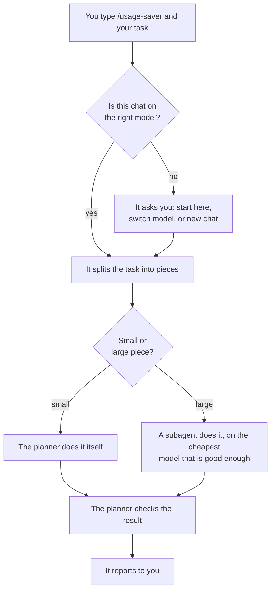

# Usage Saver

A Claude Code skill that turns your chat into a planner. The planner picks the right Claude model for every piece of work, so you stop paying top-model prices for routine jobs.

Three words you need:

- **Planner**: the chat you are talking to. It organises the work.
- **Subagent**: a helper Claude that the planner starts for one piece of work. It can run on a different, cheaper model than the chat.
- **Effort**: how hard a model thinks, from low to high. More effort costs more.

## What it does

You type `/usage-saver` and your task. From then on the chat works as a planner:

1. **It checks the chat's own model.** It tells you which Claude model and effort is enough for this task. If your chat runs on a different one, it stops and asks what you want: start here anyway, switch the model, or get a ready-made prompt for a new chat.
2. **It splits the task into pieces.**
3. **Small pieces it does itself.** Fixing a typo, changing one function, running the tests. A subagent would cost more than the work.
4. **Large pieces go to subagents.** Reading a 12,000-line log, changing 50 files, a long build-and-fix loop. Each subagent gets the cheapest model that is good enough for its piece.
5. **It checks every result** before it tells you "done". If a result is wrong, a fresh subagent gets the exact defect to fix.



Which model a subagent gets:

| The piece is about | Model and effort |
|---|---|
| Searching, reading, collecting | Haiku 5.5, high |
| Text, docs, research | Sonnet 5.5, high |
| Normal code, builds, clear bug fixes | Opus 5.5, medium |
| Unfamiliar code, unclear bugs, architecture | Fable 5.2, low to high |

The choice follows benchmark figures from Artificial Analysis, which ship with the skill in [aa-data.md](aa-data.md). Fable is the top model. The planner picks it for quality on hard pieces, never to save money.

If you want a team, say so. "Start 3 agents in parallel" or "one searches, one works, one checks" both work. The planner tells you in one sentence when that costs more, then does it.

## Install

The quickest way is to let Claude Code do it. Paste this into any chat:

```
Install this skill: https://github.com/Lampe332/claude-usage-saver
Clone it into ~/.claude/skills/usage-saver
```

Or run it yourself:

```bash
git clone https://github.com/Lampe332/claude-usage-saver ~/.claude/skills/usage-saver
```

On Windows PowerShell:

```powershell
git clone https://github.com/Lampe332/claude-usage-saver "$env:USERPROFILE\.claude\skills\usage-saver"
```

The folder has to be called `usage-saver`. Then open a new chat and type `/usage-saver` followed by your task. Tested on Windows, in the Claude Code desktop app and in the command-line version.

To update: `git -C ~/.claude/skills/usage-saver pull`. To remove it, delete that folder.

## What you see

```
> /usage-saver We're rebuilding the app in four phases. Start with phase 1.

Usage Saver on. Recommended for this job: Opus 5.5 medium
(project in phases, builder agents do the work).
This chat runs on: Fable 5.2.

Using Fable as the planner costs roughly 20 to 45% more than Opus
and counts against your Fable weekly limit.

  1. Switch (recommended)   change the model in the menu, then write "go"
  2. Start here             carry on in this chat as it is
  3. Handover prompt        pack this chat into a start prompt for a new chat, then stop
```

If the chat is already on a fitting model you get one line, "Fits, starting.", and it goes to work.

Fable 5.2 is the top Claude model as of November 2026, one tier above Opus. On subscription plans Fable has its own weekly usage limit, so every chat that runs on it uses that limit up.

## Why it works this way

I measured three things. All costs are API list prices applied to the token counts in Claude Code's own transcripts.

> [!NOTE]
> Early project. One author, one machine, single runs. See [About the numbers](#about-the-numbers) before you rely on them.

**1. The model of the chat matters most.** I ran the same seven-part coding job three times and scored each run with hidden tests that none of the models got to see.

| Chat ran on | Cost | Hidden checks passed |
|---|---|---|
| Fable 5.2, medium effort | $2.26 | 253 of 253 |
| Opus 5.5, medium effort | $1.54 | 253 of 253 |
| Sonnet 5.5, high effort | $0.85 | 253 of 253 |

Every check passed on all three, and the cheapest run cost 62% less than the dearest. It was not quite a tie: Sonnet's docs came out about half as detailed. On five small tasks the gap was smaller: $1.36 on Fable, $1.13 on Opus, $0.75 on Sonnet. This is why step 1 exists.

**2. Sending everything to subagents costs more, not less.** The first version of this skill handed every piece to a subagent. On five small tasks that cost 3.4 times as much as letting the chat do them:

| Five small tasks | Cost |
|---|---|
| The chat does everything itself | $1.36 |
| Planner plus four subagents | $4.61 |

The reason is a start-up fee. Before a subagent does anything, it has to read everything Claude Code loads at the start of a chat (tools, skills, settings). Then the planner pays three more times: for writing the task description, for waking up when the subagent reports, and for checking the result.

A step below means one action, such as reading a file or running a command.

| Subagent on | Start-up fee | With task description, report and check | Pays off from about |
|---|---|---|---|
| Haiku 5.5 | $0.01 | $0.15 | 3 steps, or lots of reading |
| Sonnet 5.5 | $0.09 | $0.25 | 8 steps |
| Opus 5.5 | $0.18 to $0.36 | $0.40 | 20 steps |
| Fable 5.2 | $0.35 to $0.74 | $0.85 | never, on cost alone |

This is why steps 3 and 4 exist: small pieces stay with the planner, large ones go out.

**3. Long runs are the real cost.** Every step re-reads the whole conversation so far, so a long chat gets more expensive with every step. On a real multi-phase app project the planner chat was 14% of the bill and the subagents that did the building were 86%. One subagent run of 160 steps cost $27 alone. So the planner cuts work into runs of about 100 steps and proposes a new chat when the current one gets long.

## When not to use it

- **For one-liners.** Loading the skill costs about 6k tokens.
- **When the chat is already on the right model and the job is small.** Then the skill only adds overhead. I measured +31% on five small tasks ($1.78 with the skill, $1.36 without) and +7% on a large clean-up ($1.91 against $1.79).
- **If you want it to switch the model for you.** Claude Code does not let a chat change its own model. The click in the model menu is yours.
- **For models other than Claude.**

Two more limits. It is a prompt, not code: the model reads the rules in `SKILL.md` and judges your task against them, and nothing enforces the outcome. And it is not proven on really hard code. Every test job was one that all three models could finish.

## Two helper scripts

Both are optional and need Node 18 or newer.

```bash
node ~/.claude/skills/usage-saver/cost.mjs
```

`cost.mjs` reads Claude Code's transcript files and prints what your recent sessions cost, main chat and subagents together, split by model. Nothing leaves your machine.

```
2026-11-13 11:38  ·  $4.61  ·  4 subagents  ·  5 min  ·  "five small tasks, old version"
   fable    $   3.30     23 calls      2.6M read      23k output
   opus     $   1.06     16 calls      1.4M read      12k output
   sonnet   $   0.25      6 calls      0.5M read       7k output
```

```bash
node ~/.claude/skills/usage-saver/aa-update.mjs
```

`aa-update.mjs` fetches the current Claude benchmark figures from Artificial Analysis and rewrites [aa-data.md](aa-data.md), which the planner uses to choose models. Run it when a new Claude model ships.

If you edit `SKILL.md`: never put a dollar sign directly before a digit. Claude Code replaces `$1`, `$2` and so on with the words typed after the command. That file writes amounts as `1.36 USD` for this reason.

## About the numbers

- Every figure is a single run. I have not measured the spread between runs.
- One author, one machine. The start-up fees were measured with about 72k tokens of base context, and the "pays off from" column is extrapolated from them.
- Dollars mean API list prices. A subscription may weigh models differently.
- The test project is synthetic: a 48-module Node project generated by a script, with three planted bugs. The hidden tests were written before the runs and checked against a reference solution.
- Models as of November 2026: Fable 5.2, Opus 5.5, Sonnet 5.5, Haiku 5.5.

## Credits

Benchmark figures are the work of [Artificial Analysis](https://artificialanalysis.ai). This project is not affiliated with them or with Anthropic.

MIT licensed, see [LICENSE](LICENSE).
